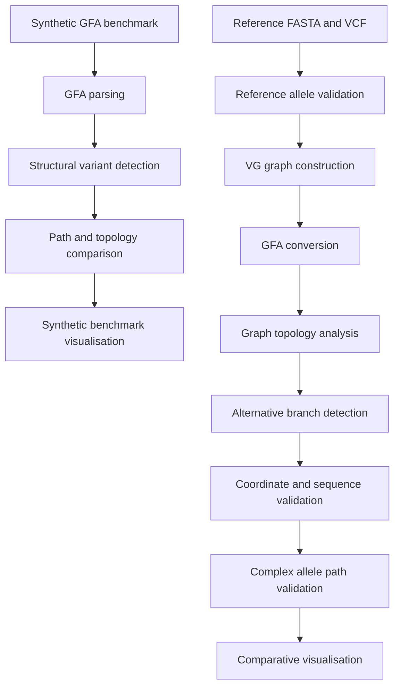
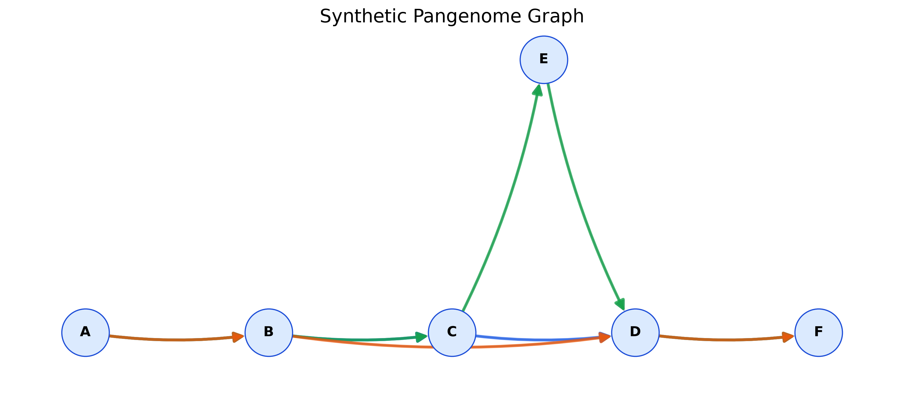
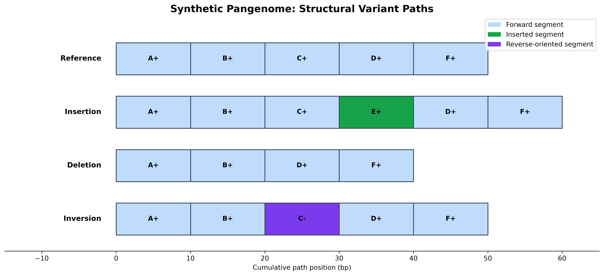
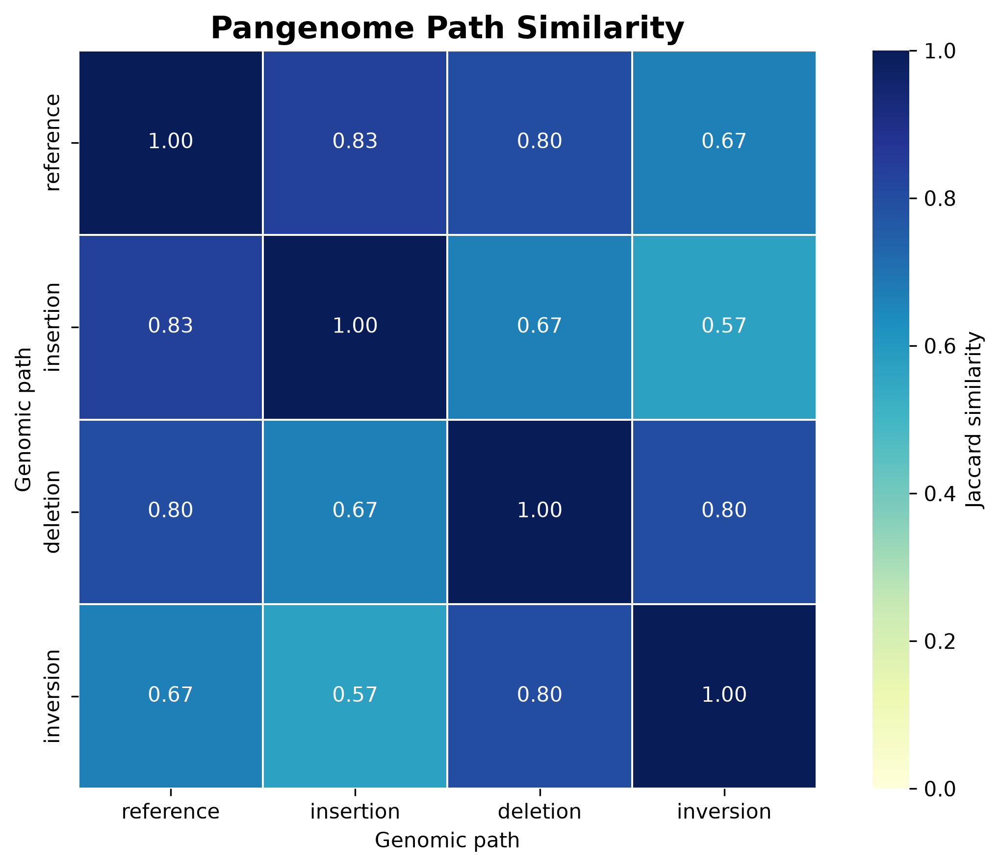
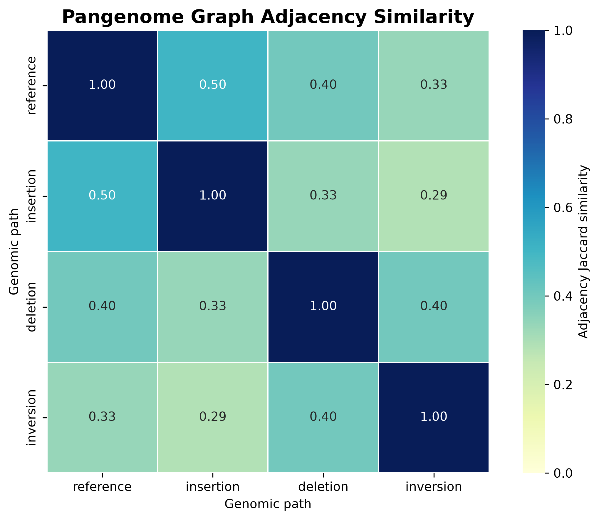
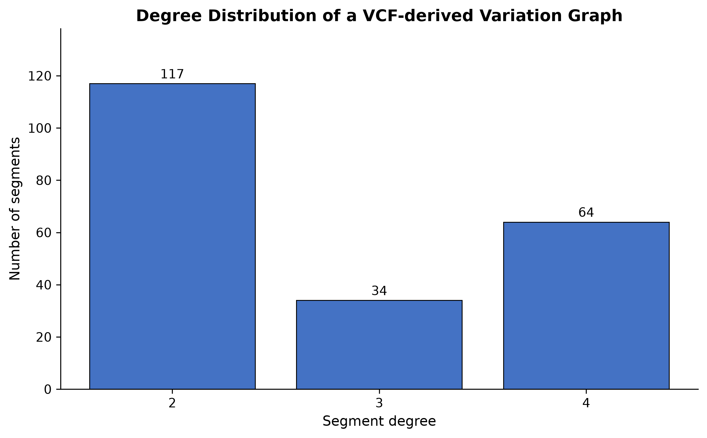
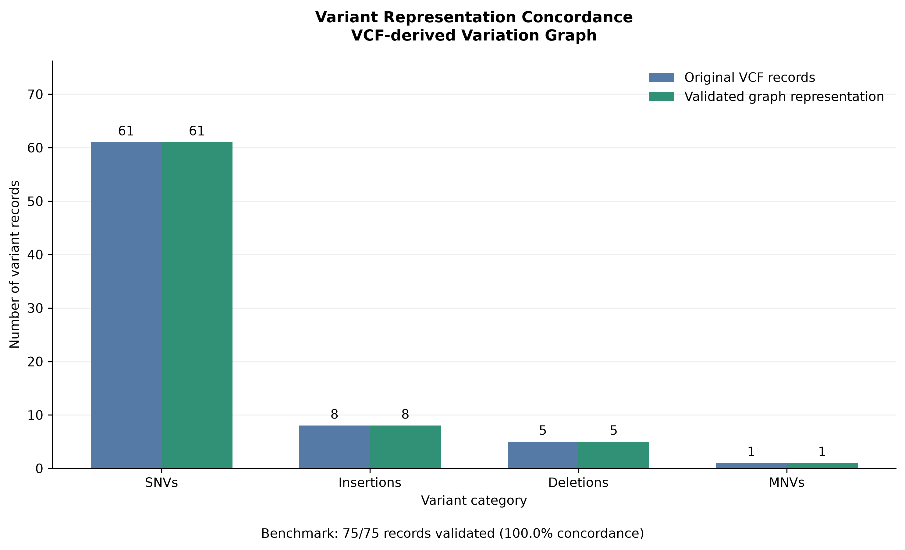
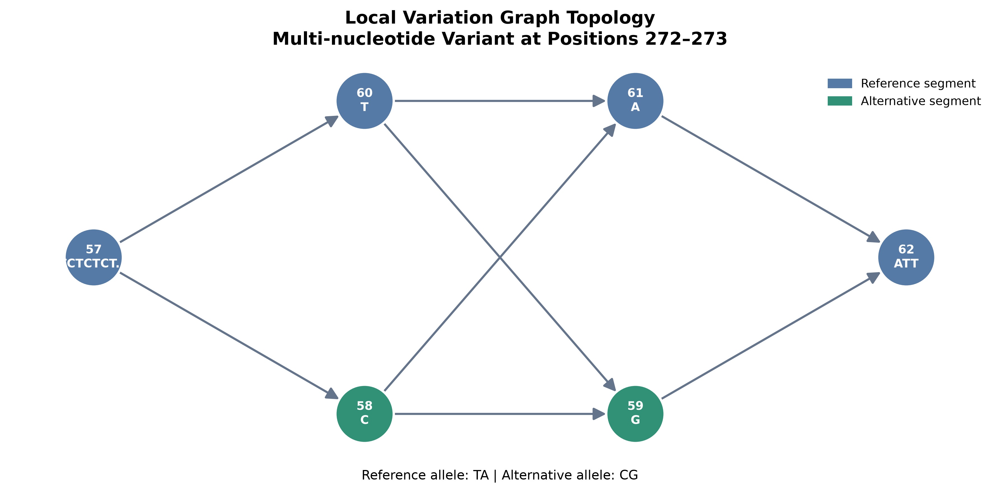

# Pangenome Graph Topology and Variant Analysis

A computational genomics project investigating sequence graph
topology, structural variation, comparative path analysis and
variant representation using Python, NetworkX, GFA and the VG
Toolkit.

## Project Overview

Linear reference genomes have limitations in representing
genetic diversity, particularly insertions, deletions,
inversions and complex alleles.

Pangenome graphs provide an alternative representation in
which multiple sequence configurations can be encoded as
connected graph paths.

This project explores two complementary approaches:

1. A controlled synthetic pangenome benchmark for structural
   variant detection and comparative graph analysis.
2. A VCF-derived variation graph for coordinate-level,
   sequence-level and path-level variant validation.

## Objectives

- Parse and analyse GFA sequence graphs.
- Identify insertion, deletion and inversion events in
  controlled graph paths.
- Compare graph paths using node and adjacency similarity.
- Characterise graph topology and connectivity.
- Construct variation graphs using the VG Toolkit.
- Identify reference-anchored alternative branches.
- Validate graph-derived variants against original VCF alleles.
- Investigate differences between graph connectivity and
  biological haplotype representation.
- Develop reproducible scientific visualisations.

## Technologies

| Category | Tools |
|---|---|
| Programming | Python 3.11 |
| Graph analysis | NetworkX |
| Genomic data processing | pysam |
| Data analysis | pandas, NumPy, SciPy |
| Visualisation | Matplotlib, Seaborn |
| Graph construction | VG Toolkit v1.78.0 |
| File formats | GFA, VG, FASTA, VCF |
| Containerisation | Docker |
| Testing | pytest |
| Version control | Git |

## Computational Workflow



## Part I: Synthetic Pangenome Benchmark

A controlled graph was generated containing six sequence
segments and four paths representing:

- Reference sequence
- Insertion
- Deletion
- Inversion

### Synthetic Graph



### Structural Variant Detection

Reference and alternative paths were compared using
orientation-aware sequence segment representations.

| Variant | Expected event | Length change |
|---|---|---:|
| Insertion | Addition of an alternative segment | +10 bp |
| Deletion | Removal of a reference segment | -10 bp |
| Inversion | Reversal of segment orientation | 0 bp |



### Comparative Path Analysis

Pairwise path similarity was calculated using the Jaccard
similarity of oriented sequence segments.



### Comparative Graph Topology

Oriented adjacency relationships were compared to investigate
structural differences between graph paths.



## Part II: VCF-Derived Variation Graph

A small benchmark dataset from the official VG Toolkit
repository was used to construct and analyse a variation graph.

The dataset contains a 1,001 bp reference sequence and
75 original VCF records.

All reference alleles were checked against the FASTA sequence
before graph construction.

### Graph Topology

| Metric | Result |
|---|---:|
| Reference sequence length | 1,001 bp |
| Original VCF records | 75 |
| Graph segments | 215 |
| Graph links | 296 |
| Reference segments | 144 |
| Non-reference segments | 71 |
| Connected components | 1 |
| Maximum undirected degree | 4 |

Degree and connectivity statistics were calculated using
an undirected simple graph projection.



### Alternative Branch Detection

Reference-anchored graph branches were identified through
graph connectivity and sequence comparisons.

The analysis identified:

- 63 substitution-like single-segment branches.
- 8 insertion-like branches.
- 5 deletion-like reference-skipping edges.

These graph features do not correspond one-to-one with
original VCF records because complex alleles can be
represented by multiple graph components.

## Variant Representation Validation

Graph-derived events were compared against the original
VCF records using reference coordinates, nucleotide sequences,
allele lengths and connected graph paths.

| Variant category | VCF records | Validated records |
|---|---:|---:|
| Single-nucleotide variants | 61 | 61 |
| Insertions | 8 | 8 |
| Deletions | 5 | 5 |
| Multi-nucleotide variants | 1 | 1 |
| **Total** | **75** | **75** |

All 75 original VCF records were represented in the
constructed variation graph.



The 100% concordance describes representation of the input
variants in this specific benchmark. It does not measure
independent variant-calling accuracy.

## Complex Allele and Local Graph Topology

A multi-nucleotide variant at reference positions 272–273
was investigated in greater detail.

Original reference allele: TA

Original alternative allele: CG

The graph represented this allele through two connected
single-nucleotide alternative segments.

The complete alternative path was validated by graph
traversal and sequence reconstruction.



The local graph permits four sequence combinations:

| Allele | Interpretation |
|---|---|
| TA | Original reference allele |
| CG | Original alternative allele |
| TG | Additional graph-permitted combination |
| CA | Additional graph-permitted combination |

This demonstrates that graph connectivity can permit
sequence combinations beyond the original input alleles.

A traversable graph path does not necessarily represent
an observed or phased biological haplotype.

## Repository Structure

```text
Pangenome-Graph-Topology-and-Variant-Analysis/
├── data/
│   ├── raw/
│   └── processed/
├── docs/
│   ├── DATA_SOURCES.md
│   └── data_checksums.sha256
├── results/
│   ├── figures/
│   └── tables/
├── src/
├── tests/
│   └── test_structural_variants.py
├── requirements.txt
├── .gitignore
└── README.md
```

## Analysis Scripts

| Script | Purpose |
|---|---|
| 01_generate_test_graph.py | Generate synthetic GFA benchmark |
| 02_parse_gfa.py | Parse graph segments, links and paths |
| 03_detect_structural_variants.py | Detect synthetic structural variants |
| 04_visualize_pangenome.py | Visualise synthetic graph |
| 05_visualize_structural_variants.py | Visualise variant paths |
| 06_compare_pangenome_paths.py | Compare oriented graph paths |
| 07_visualize_path_similarity.py | Generate path similarity heatmap |
| 08_compare_graph_topology.py | Compare oriented adjacency relationships |
| 09_visualize_graph_topology.py | Generate topology heatmap |
| 10_inspect_real_variants.py | Inspect benchmark VCF records |
| 11_validate_reference_variants.py | Validate reference alleles |
| 12_analyse_real_graph.py | Analyse graph topology |
| 13_visualize_real_graph.py | Visualise degree distribution |
| 14_inspect_oriented_links.py | Inspect graph link orientations |
| 15_detect_simple_bubbles.py | Identify candidate alternative branches |
| 16_validate_bubble_sequences.py | Compare branch sequences |
| 17_detect_reference_skips.py | Identify deletion-like edges |
| 18_validate_deletion_coordinates.py | Validate deletion coordinates and sequences |
| 19_validate_insertion_coordinates.py | Validate insertion coordinates and sequences |
| 20_validate_snv_coordinates.py | Validate single-nucleotide substitutions |
| 21_validate_complex_allele.py | Validate complex allele paths |
| 22_visualize_variant_validation.py | Generate concordance summary |
| 23_visualize_local_variation_graph.py | Visualise local graph topology |

## Installation

Python 3.11 and Docker are required for the complete workflow.

```bash
python3 -m venv .venv
source .venv/bin/activate
python -m pip install -r requirements.txt
```

## Reproducing the Synthetic Benchmark

Run the first nine scripts in numerical order:

```bash
for script in src/0[1-9]_*.py; do
    python "$script" || exit 1
done
```

## Reproducing the VCF-Derived Graph

### Download Benchmark Data

```bash
mkdir -p data/raw/vg_example
mkdir -p data/processed/vg_example

curl -fL \
    https://raw.githubusercontent.com/vgteam/vg/master/test/small/x.fa \
    -o data/raw/vg_example/x.fa

curl -fL \
    https://raw.githubusercontent.com/vgteam/vg/master/test/small/x.vcf.gz \
    -o data/raw/vg_example/x.vcf.gz
```

Verify the downloaded input checksums against
`docs/data_checksums.sha256` before continuing.

### Index Genomic Inputs

```bash
python - <<'PY'
import pysam

pysam.faidx("data/raw/vg_example/x.fa")

pysam.tabix_index(
    "data/raw/vg_example/x.vcf.gz",
    preset="vcf",
    force=True,
    keep_original=True
)
PY
```

### Construct the Variation Graph

The tested VG container is pinned by its image digest.

```bash
VG_IMAGE="quay.io/vgteam/vg@sha256:febc2401166d4acd81cbf07d89158feccee8c13de70613f72e641d48ceea4ca8"

docker run --rm \
    --platform linux/amd64 \
    -v "$PWD:/work" \
    -w /work \
    "$VG_IMAGE" \
    vg construct \
    -r data/raw/vg_example/x.fa \
    -v data/raw/vg_example/x.vcf.gz \
    > data/processed/vg_example/x.vg
```

### Convert VG to GFA

```bash
docker run --rm \
    --platform linux/amd64 \
    -v "$PWD:/work" \
    -w /work \
    "$VG_IMAGE" \
    vg convert -f data/processed/vg_example/x.vg \
    > data/processed/vg_example/x.gfa
```

### Run Graph Analysis and Validation

```bash
for script in src/1[0-9]_*.py src/2[0-3]_*.py; do
    python "$script" || exit 1
done
```

## Unit Testing

```bash
python -m pytest tests/ -v
```

Test results: 8/8 passing.

The unit tests cover controlled synthetic structural
variant detection, expected sample paths, insertion and
deletion segments, variant coordinates and inversion
orientation.

The VCF-derived graph is evaluated separately through
coordinate, sequence and path validation.

## Scientific Limitations

- The synthetic benchmark contains a limited number of
  controlled structural variants.
- The VG dataset is a small software-testing fixture rather
  than a population-scale biological pangenome.
- The VCF-derived insertions and deletions are small indels,
  not large structural variants.
- The branch detection algorithms are tailored to simple,
  forward-oriented graph structures.
- General bidirected graph traversal and complex rearrangements
  are not comprehensively supported.
- The undirected graph projection simplifies orientation
  and edge multiplicity.
- Representation concordance does not establish independent
  variant-calling sensitivity or specificity.
- Graph-permitted paths do not necessarily correspond to
  observed biological haplotypes.
- Genome-scale computational performance has not been assessed.

## Future Research Directions

- Population-scale pangenome construction and comparison.
- Orientation-aware bidirected graph algorithms.
- Complex structural variant and rearrangement detection.
- Haplotype-aware graph traversal.
- Comparative graph analysis across species.
- Synteny and conserved genomic region identification.
- Scalable and interactive pangenome visualisation.
- Benchmarking against established graph-based methods.

## Data Sources and Reproducibility

Benchmark data originate from the official VG Toolkit
repository:

https://github.com/vgteam/vg

Detailed data provenance, software versions and file
checksums are documented in the `docs/` directory.

Upstream benchmark inputs can be downloaded using the
instructions above.

## References

Garrison E, et al. Variation graph toolkit improves read
mapping by representing genetic variation in the reference.
Nature Biotechnology. 2018;36:875–879.

https://doi.org/10.1038/nbt.4227

GFA specification:
https://github.com/GFA-spec/GFA-spec

VG Toolkit:
https://github.com/vgteam/vg

## Author

Janhavi Vanjari

MSc Bioinformatics — Ghent University, Belgium

BTech Bioengineering — Vellore Institute of Technology, India

GitHub: https://github.com/janhavj
